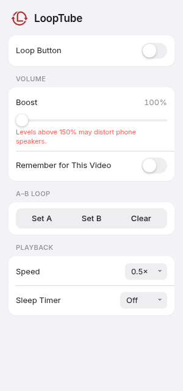
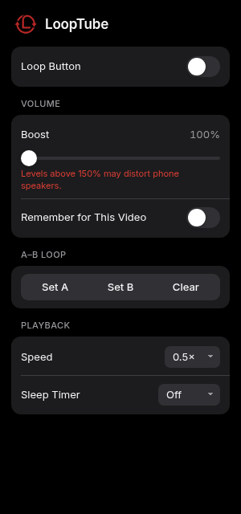
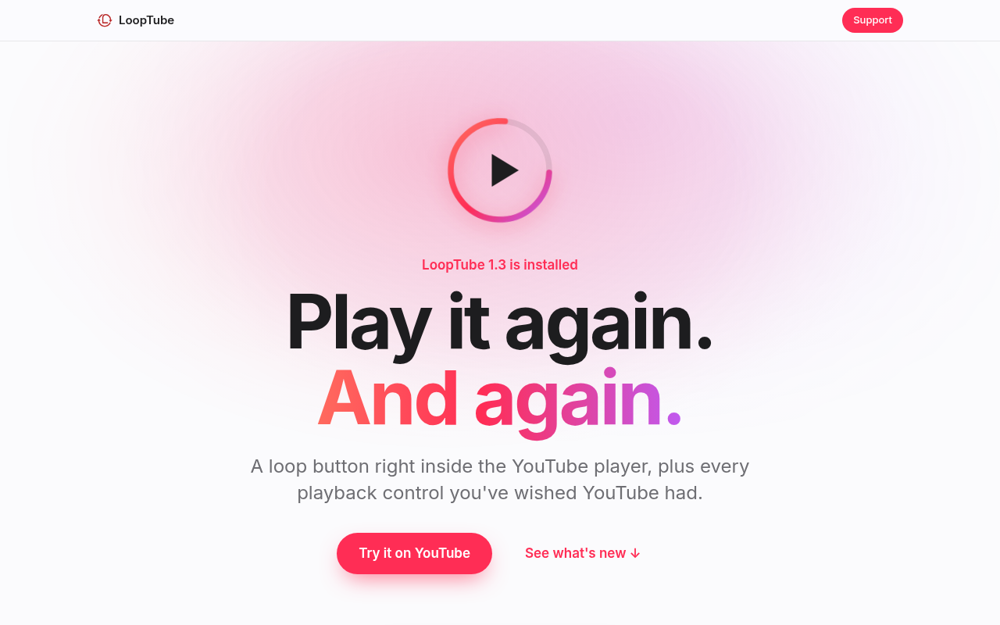

# LoopTube

[](https://addons.mozilla.org/en-US/firefox/addon/looptube/)


A lightweight Firefox extension that adds a native-feeling loop button directly inside the YouTube video player, plus a studio-grade volume booster for quiet videos.

---

<p align="center">
  
  &nbsp;
  
</p>
<p align="center"><em>The redesigned popup in light and dark mode</em></p>

<p align="center">
  
</p>
<p align="center"><em>The welcome page that opens after a fresh install</em></p>

---

## Overview

LoopTube gives you total control over YouTube's playback natively. It integrates a loop control directly into the player interface and features a custom audio pipeline to safely push video volume past hardware limits without blowing out your speakers.

Built to stay lightweight, responsive, and visually consistent with YouTube’s UI across both desktop and mobile layouts.

---

## What's New in v1.3

* A–B loop to repeat just part of a video
* Playback speed from 0.5× to 3×
* Sleep timer that pauses after 15 to 90 minutes
* Per-video volume boost memory
* Redesigned Apple-style popup with light and dark mode
* A welcome guide on first install
* Fixed: turning off the loop button no longer stops background playback or resets the volume boost

See [CHANGELOG.md](CHANGELOG.md) for the full history.

---

## Features

* Native-style loop button integrated into YouTube controls
* Toggle loop instantly with one click
* Safe 350% volume boost using dynamic brickwall compression
* Keyboard shortcut (**L**) on desktop
* Full mobile YouTube support
* Background playback support on mobile Firefox
* Remembers loop and audio states per video
* A–B loop, speed control, and sleep timer from the popup
* Works with autoplay and dynamic navigation
* Reliable handling of YouTube UI re-renders
* Controls appear and disappear naturally with YouTube overlays
* Lightweight with no external dependencies

---

## Installation

### Firefox Add-ons

[Download LoopTube directly from the Firefox Add-ons store](https://addons.mozilla.org/en-US/firefox/addon/looptube/) for automatic updates and secure installation.


## Privacy

LoopTube does not collect, store, or transmit any user data.

All functionality runs locally within the browser.

---

## Permissions

* `storage` — used only to save loop and volume preferences locally

---

## Compatibility

* Firefox Desktop
* Firefox for Android
* YouTube Desktop (`www.youtube.com`)
* YouTube Mobile Web Interface

---

## Project Structure

```text
looptube/
├── manifest.json
├── content.js
├── popup.html
├── popup.js
├── style.css
├── icons/
└── assets/

---

## Install from Source

```bash
npm install
npm run build     # bundles src/ into dist/
npm start         # opens Firefox with the extension loaded
npm run lint      # web-ext lint on the built extension
npm run package   # store-ready zip in artifacts/
```

Or load it by hand: open `about:debugging#/runtime/this-firefox`, click **Load Temporary Add-on**, and pick `dist/manifest.json`.

## Project Structure

```
src/
  manifest.json
  content/              # content script, split by feature and concatenated in order
    00-config.js        # constants, state, storage helpers
    10-volume-boost.js  # Web Audio volume booster
    20-player.js        # player, video, and controls lookup
    30-loop.js          # per-video loop state
    40-mobile-input.js  # m.youtube.com touch handling
    50-button.js        # loop button creation and placement
    60-lifecycle.js     # ads, DOM observer, shortcuts
    70-background-play.js
    75-extras.js        # A-B loop, speed, sleep timer, per-video volume
    80-main.js          # start/stop, navigation, messages
    style.css
  popup/                # toolbar popup (HTML, CSS, JS)
  welcome/              # welcome page bundled in the extension (also deployable to Netlify)
  background.js         # opens the welcome page on a fresh install
icons/
docs/screenshots/
scripts/build.js
```
