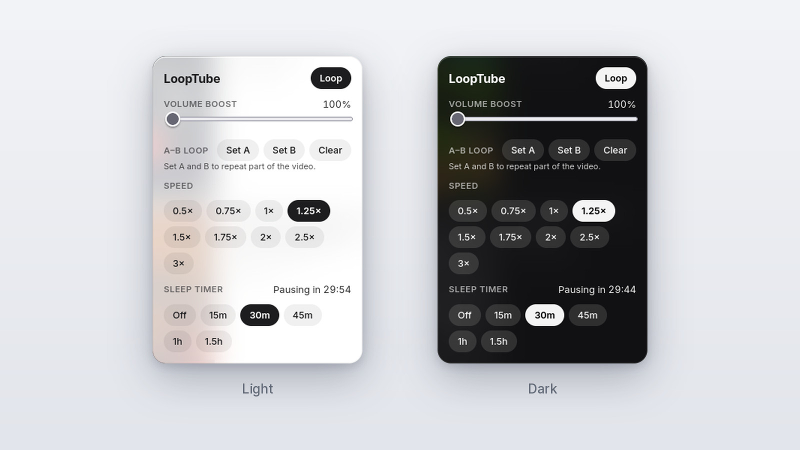

<p align="center">
  
</p>

<h1 align="center">LoopTube</h1>

<p align="center">
  A loop button for the YouTube player, plus A–B repeat, speed, sleep timer, volume boost and background play.<br>
  Open-source Firefox extension for desktop and Android.
</p>

<p align="center">
  <a href="https://addons.mozilla.org/en-US/firefox/addon/looptube/"></a>
  <a href="https://addons.mozilla.org/en-US/firefox/addon/looptube/"></a>
  <a href="https://github.com/shalinchristian/LoopTube/actions/workflows/lint.yml"></a>
  
  <a href="LICENSE"></a>
</p>

<p align="center">
  <a href="https://addons.mozilla.org/en-US/firefox/addon/looptube/"><b>Get it on Firefox Add-ons</b></a>
  &nbsp;·&nbsp;
  <a href="#features">Features</a>
</p>

## Install

Get LoopTube from [Firefox Add-ons](https://addons.mozilla.org/en-US/firefox/addon/looptube/).

Requires Firefox 128 or newer, on desktop or Android. Works on `www.youtube.com` and `m.youtube.com`.

## Features

| Feature | What it does |
|---|---|
| **Loop button** | Adds a loop toggle to YouTube's own player controls. Shortcut: <kbd>Shift</kbd> + <kbd>L</kbd>. |
| **Floating controls** | A small button on video pages opens a quick panel with every control below. It matches YouTube's light or dark theme, can be dragged anywhere, and can be turned off in the popup. |
| **A–B repeat** | Set a start and end point to loop just one section. |
| **Playback speed** | 0.5× to 3×. |
| **Sleep timer** | Pauses after 15, 30, 45, 60 or 90 minutes, with a live countdown. |
| **Volume boost** | Up to 350% for quiet videos, with a limiter to prevent clipping. Only active above 100%. |
| **Background play** | On Firefox for Android, keeps playing with the screen locked or in another app. Stops when Firefox closes the page. |
| **Per-video memory** | Loop stays on for videos you looped before. Boosted volume can be saved for a single video from the popup. |

<p align="center">
  
</p>

## Two ways to use it

1. **On the video:** tap the floating LoopTube button to open the quick panel without leaving the player.
2. **From the toolbar:** click the LoopTube icon in Firefox's toolbar (or the extensions menu on Android) for the same controls, plus the setting to show or hide the floating button.

## Project structure

```
src/
├── content/        content script, one numbered file per feature, joined in order at build time
├── page/           background-play helper that runs in YouTube's page (Android)
├── popup/          toolbar popup
├── welcome/        page shown once after install
├── background.js
└── manifest.json   version is filled in from package.json at build time
scripts/build.js    build script
docs/screenshots/   images used in this README
```

Plain JavaScript and CSS. No frameworks and no runtime dependencies.

## Privacy

LoopTube collects no data. Its only permission is `storage`, used to save your settings on your device.

## Contributing

Bug reports, ideas and pull requests are welcome. See [CONTRIBUTING.md](CONTRIBUTING.md), or [open an issue](https://github.com/shalinchristian/LoopTube/issues).

## License

[MIT](LICENSE) © Shalin Christian
